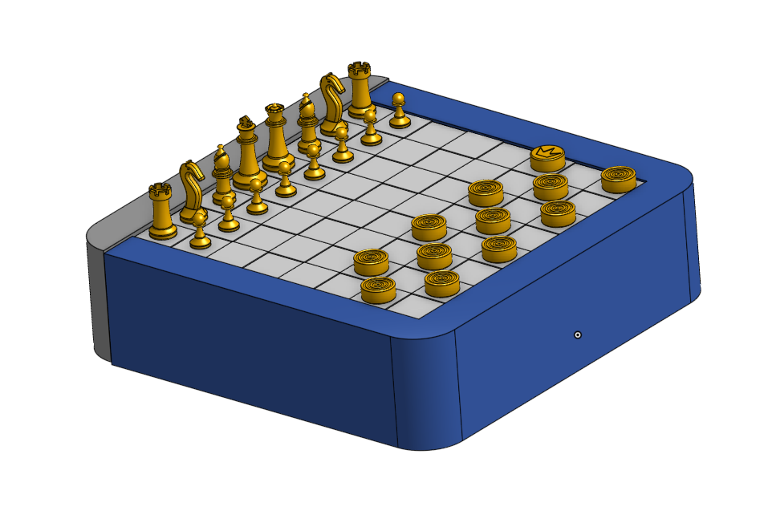

# Chess / Checkers Game Board

## Overview

This project was built for week 2 of Hack Club's Hardware program [Half Life](https://halflife.hackclub.com), a 10 week YSWS to help beginners learn hardware projects.

The tutorial project for this week was [Merbl Run](https://github.com/karnxx/merbl/) by [karnxx](https://github.com/karnxx/).

This project does not follow the tutorial, due to past experience with the Onshape software.

My project for this week is a 3D print model for a portable chess and checkers set!! :DDD

## Features

The design features a sliding tray, along with 34 standard chess pieces (King, 2 Queens, 2 Rooks, 2 Bishops, 2 Knights, 8 Pawns for both sides.), as well as 24 standard checkers pieces, (12 for either colour.)

The checkers pieces also feature a regular side and a king side for promotion.

Uses squares of slight elevational variation as 3D printing the board can only use one colour, so black/white squares can be distinguished by altitude.

## AI Usage

AI was not used in any way for this project.